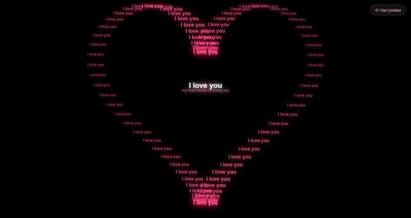
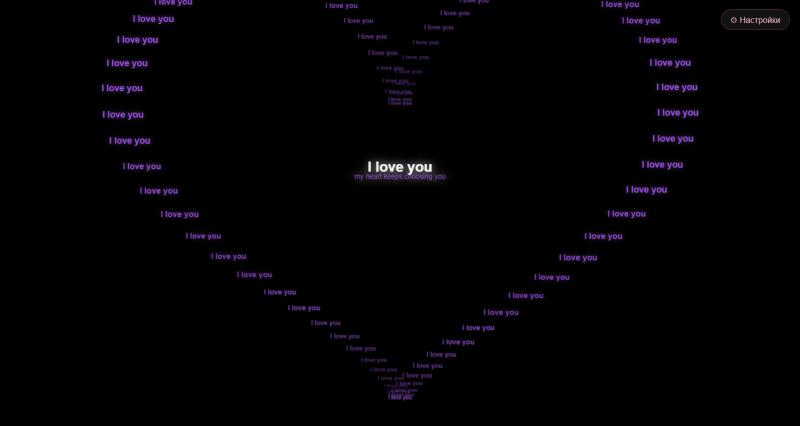
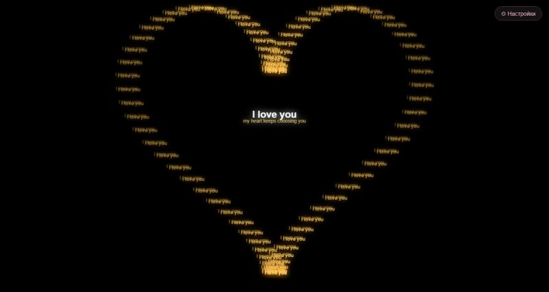
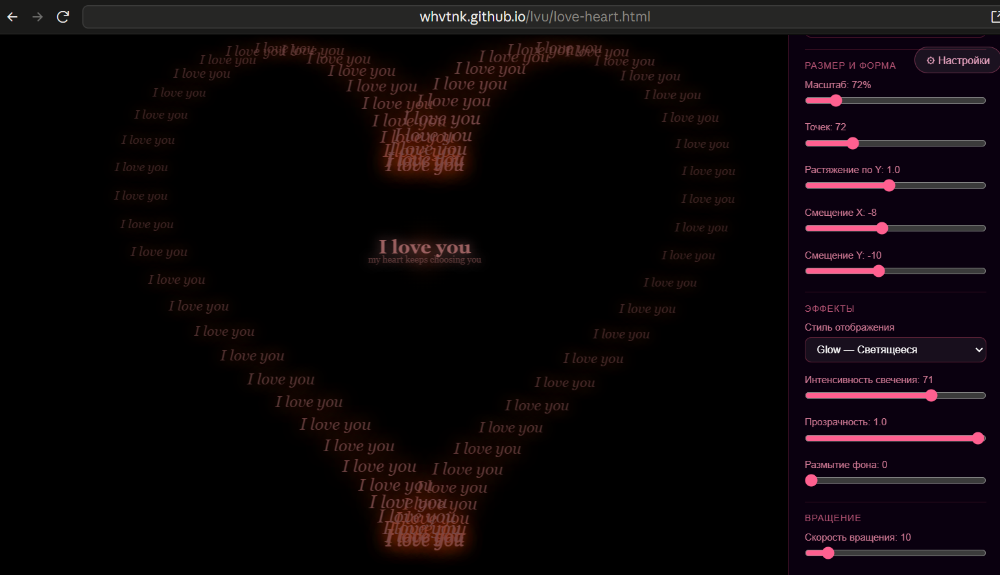
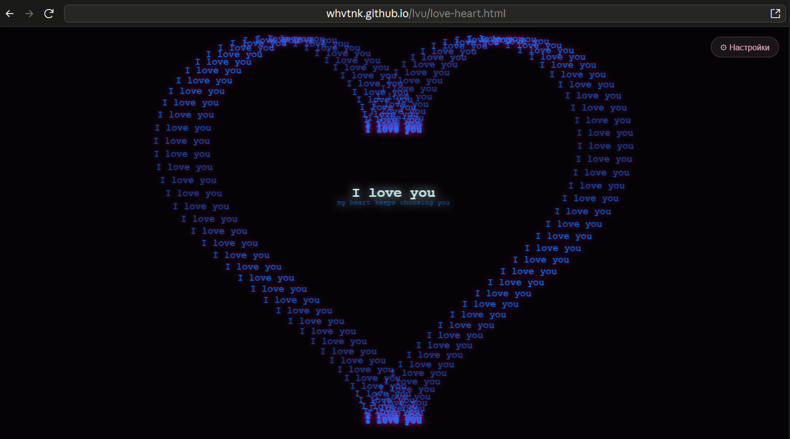

# Love Heart

**[Открыть онлайн](https://whvtnk.github.io/lvu/love-heart.html)**

Анимированное сердце из слов на HTML5 Canvas. Всё в одном файле, без зависимостей.

## Демо

https://github.com/user-attachments/assets/9295bd77-7cee-4c28-add6-08271b1b9e4d

## Варианты оформления

| Glow | Ghost | Double |
|---|---|---|
|  |  |  |

| Приглушённый | Синий Glow |
|---|---|
|  |  |

## Запуск

Открой `love-heart.html` в браузере — никакой установки не нужно.

## Возможности

- Сердце из повторяющегося текста с настраиваемым словом/фразой
- Центральный заголовок и подзаголовок
- **5 стилей отображения**: Glow, Ghost, Volume 3D, Outline, Double
- **5 стилей вращения**: Uniform, Pendulum, Pulse, Chaotic, Spiral
- **5 типов волны**: Smooth, Flash, Radial, Double, Random
- Настройка цветов, размера, шрифта, свечения, прозрачности
- Анимированные звёзды на фоне
- Все настройки применяются в реальном времени через боковую панель

## Настройки

Нажми **⚙ Настройки** в правом верхнем углу — откроется панель с полным управлением над внешним видом.
